# Go81

[](https://github.com/wilsonpilon/go81/actions/workflows/ci.yml)

> Um ambiente completo de desenvolvimento e emulação para o **Sinclair ZX81** e seus clones, escrito em **Go**.

**Versão atual:** `1.10.8` — *Sinclair · Rocket Man · "Fitas em som"* (ZX81 numa janela com som, no terminal, pela linha de comando e pelo shell, com console de comandos; porta de comunicação por TCP, stdio, socket e pipe, compatível com o ZRCP do ZEsarUX; carrega, grava e lista programas `.p` e os cria a partir de BASIC em texto)

---

## O que é

O Go81 é um "mega emulador" do ZX81 que junta, em um único programa, tudo que um desenvolvedor
de ZX81 precisa:

| Ferramenta | O que faz |
|---|---|
| **Emulador** | ZX81, ZX80, Timex TS1000 e TS1500, Lambda 8300, Ringo R-470, TK85, ZX97 Lite e Jupiter Ace, com meta de 100% de compatibilidade com o EightyOne 1.41 |
| **Editor de BASIC** | No lugar da tela do ZX81 (F7), como a edição do próprio ZX81: digitação direta ou com as teclas do ZX81 (cursores K, L, F, G), sintaxe conferida pela ROM, RENUM, AUTO, FIND, DELETE e RUN direto no emulador |
| **Compilador BASIC (Dignified)** | Dialeto moderno, sem números de linha, com rótulos, nomes longos e `include`, que gera BASIC ZX81 tokenizado (`.p`) |
| **Editor de textos** | Editor geral para fontes, notas e scripts |
| **Montador Z80** | Assembler/disassembler com macros, rótulos e saída `.p`, `.bin`, `.hex` e REM-embutido |
| **Gerador de fitas** | Cria e converte `.p`, `.81`, `.p81`, `.tzx`, `.wav` |
| **Depurador** | Breakpoints, passo a passo, memória ao vivo, histórico e profiler |
| **Porta de comunicação (Link)** | Canal TCP/pipe para outros programas controlarem o emulador e trocarem dados com o programa ZX81 em execução |

Tudo pode ser usado de três formas:

- **GUI** — janelas com [Fyne](https://fyne.io)
- **TUI** — interface de terminal com [tview](https://github.com/rivo/tview) / [tcell](https://github.com/gdamore/tcell)
- **CLI** — um pequeno "sistema operacional" de linha de comando, além de muitos parâmetros para automação pelo shell do Windows e do Linux

## Capturas de tela

<table>
<tr>
<td width="50%" valign="top">
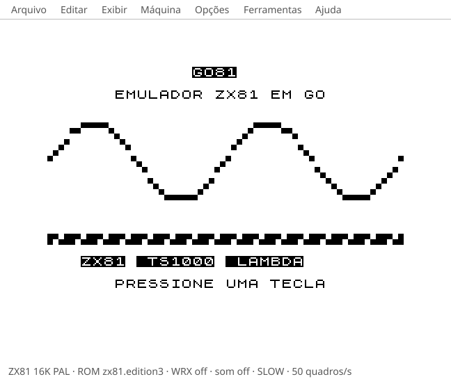
<p align="center"><b>Janela</b> (<code>go81 gui</code>): o ZX81 com som, menus e configuração do hardware.</p>
</td>
<td width="50%" valign="top">
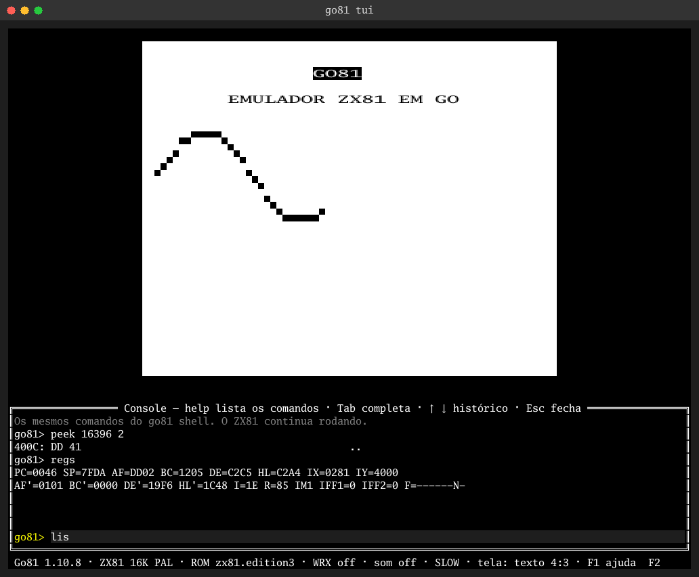
<p align="center"><b>Terminal</b> (<code>go81 tui</code>): a mesma máquina em texto, com o console de comandos (F2).</p>
</td>
</tr>
<tr>
<td width="50%" valign="top">
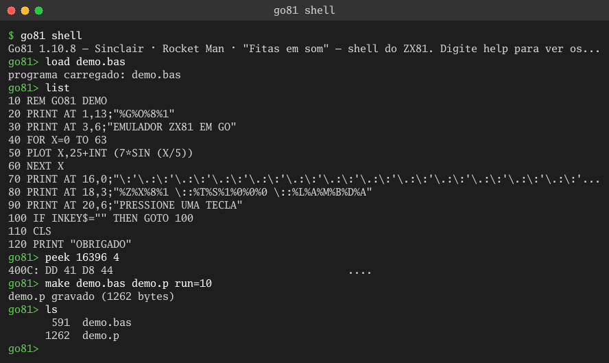
<p align="center"><b>Shell</b> (<code>go81 shell</code>): carregar um programa em texto, listar, ler a memória, gerar o <code>.p</code>.</p>
</td>
<td width="50%" valign="top">
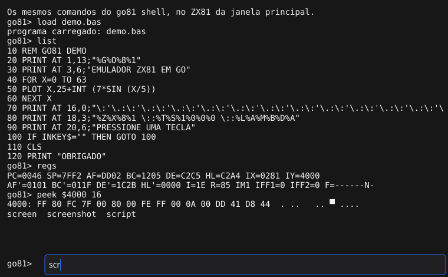
<p align="center"><b>Console da janela</b> (F2): os comandos do shell, com histórico e Tab, no ZX81 da janela.</p>
</td>
</tr>
<tr>
<td colspan="2" align="center">
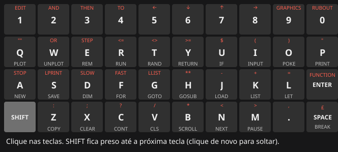
<p align="center"><b>Teclado na tela</b> (F3): as 40 teclas do ZX81 para clicar; o SHIFT fica preso até a próxima tecla.</p>
</td>
</tr>
<tr>
<td colspan="2" align="center">
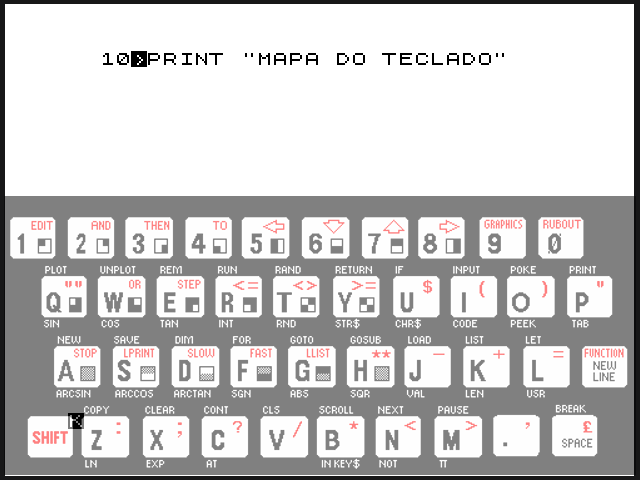
<p align="center"><b>Mapa do teclado</b> (F4): o teclado do modelo sobre a tela, esmaecido, opaco ou só enquanto SHIFT estiver apertado.</p>
</td>
</tr>
<tr>
<td colspan="2" align="center">
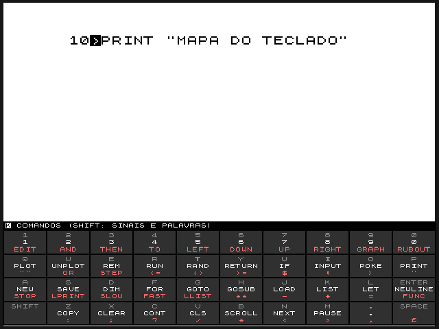
<p align="center"><b>Teclas do cursor</b> (CTRL com o mapa ligado): o que cada tecla faz no cursor atual do ZX81 — K, L, F ou G — e com SHIFT.</p>
</td>
</tr>
<tr>
<td colspan="2" align="center">
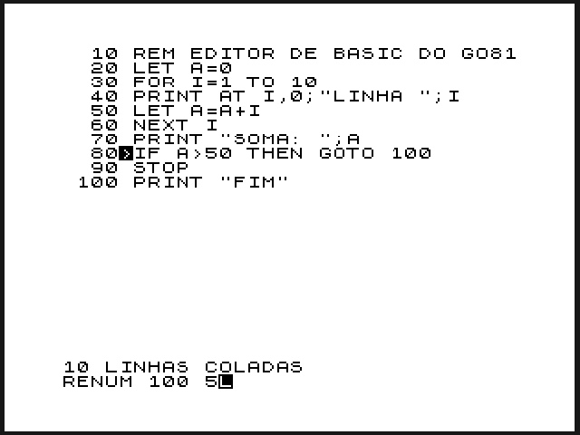
<p align="center"><b>Editor de BASIC</b> (F7): no lugar da tela, como a edição do ZX81 — listagem com o cursor de linha em cima, entrada embaixo, RENUM, AUTO, FIND e mais.</p>
</td>
</tr>
<tr>
<td width="50%" valign="top">
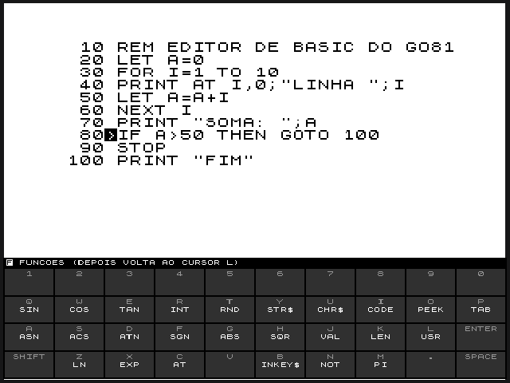
<p align="center"><b>Teclas do ZX81 no editor</b> (F8): K dá o comando, L a letra, SHIFT+ENTER o cursor F das funções, SHIFT+9 os gráficos; CTRL mostra o que cada tecla dá.</p>
</td>
<td width="50%" valign="top">
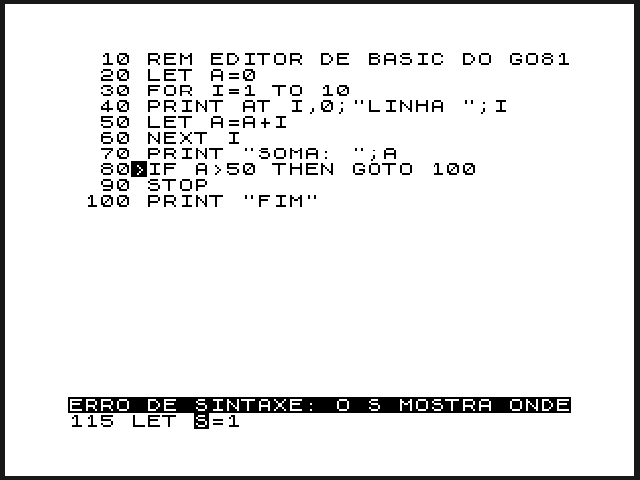
<p align="center"><b>Sintaxe pela ROM</b>: cada linha passa pela rotina LINE-SCAN do ZX81; uma linha errada não entra e o <b>S</b> marca onde está o erro.</p>
</td>
</tr>
<tr>
<td colspan="2" align="center">
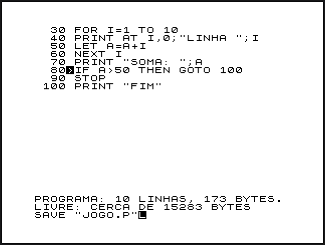
<p align="center"><b>Arquivos e memória no editor</b>: LOAD, SAVE e MERGE direto no editor, MEM com os bytes usados e livres, e Ctrl+↑↓ para rolar a listagem sem perder a linha atual.</p>
</td>
</tr>
</table>

O programa nas imagens é o [`examples/demo.bas`](examples/demo.bas), escrito em texto e transformado em `.p` pelo
próprio Go81. As capturas são geradas pelo programa (`tools/screenshots.ps1`).

## Estado do projeto

O ZX81 já roda pela linha de comando e é idêntico ao EightyOne quadro a quadro, conferido contra o código C++ original.
Já carrega, grava e lista programas `.p`, roda numa janela ou no terminal (os dois com um console de comandos,
F2), tem um shell de comandos com histórico e Tab, e uma porta de comunicação para outros programas (protocolo
próprio por TCP, stdio, socket ou pipe, e compatível com o ZRCP do ZEsarUX). Exemplos:

```sh
go81 gui jogo.p
go81 tui jogo.p
go81 run --frames 600 --keys "1,0,P,SHIFT+P,O,L,A,SHIFT+P,ENTER,R,ENTER" --screenshot tela.png
go81 run --frames 700 --keys-start 450 --keys "R,ENTER" --screenshot tela.png jogo.p
go81 shell -c 'typeln 10P"OLA"; typeln R; screen'
go81 shell examples/ola.g81
go81 link jogo.p        # telnet 127.0.0.1 8181 (Go81) ou 10000 (ZRCP)
go81 gui -link jogo.p   # a janela, controlada de fora
go81 p2txt jogo.p       # o programa como texto (formato do zxtext2p): jogo.txt
go81 txt2p jogo.txt     # e de volta: texto -> jogo.p (também *.txt, *.p)
```

As próximas ferramentas já estão especificadas na [SPEC.md](SPEC.md), a partir do estudo de programas clássicos:
o montador **asm81** (sintaxe do asMSX e editor no estilo do Mega Assembler), o BASIC moderno **ZX Dignified**
(base no zxtext2p e no Basic Dignified Suite), o **depurador** no estilo do Super-X, e ideias do VB81 XuR e do
ZEsarUX.

Veja:

- [SPEC.md](SPEC.md) — especificação completa
- [OUTLINE.md](OUTLINE.md) — documento vivo: o que existe, o que foi testado, o que falta
- [RELEASE.md](RELEASE.md) — histórico de versões
- [MANUAL.md](MANUAL.md) — manual do usuário
- [resume.txt](resume.txt) — resumo do projeto em texto simples
- [RESOURCES.md](RESOURCES.md) — o que fica fora do GitHub (referências, configurações) e como remontar o projeto em outro PC

## Compilando

Requer **Go 1.25 ou mais novo** (desenvolvido com Go 1.27).

No Windows, o jeito mais simples é o script de build, que instala o que faltar (Go e gcc do MSYS2), roda os
testes e gera o pacote de distribuição em `dist\` (pasta + `go81-X.Y.Z-windows-amd64.zip` + `.sha256`):

```powershell
.\build.ps1               # completo
.\build.ps1 -SkipTests    # mais rápido
```

No Linux e no macOS, o mesmo com `./build.sh` (`--skip-tests`, `--nogui`, `--install-deps`), que gera o
`go81-X.Y.Z-linux-amd64.tar.gz`. Os releases trazem os pacotes de Windows e de Linux prontos.

Manualmente:

```sh
go build -o bin/ ./cmd/go81
./bin/go81 --version
```

Testes:

```sh
go test ./...                                         # inclui a comparação com o EightyOne (precisa do gcc, por causa da janela)
go test -tags nogui ./...                             # sem compilador C
GO81_LONG=1 go test ./internal/emu/z80/ -run Zex -v   # ZEXDOC/ZEXALL (alguns minutos)
go run ./test/compat/z80diff                          # compara o Z80 com o C original (precisa de gcc e 81emul/)
go run ./test/compat/zx81diff                         # compara a máquina ZX81 com o zx81.cpp original (g++)
```

A janela (Fyne) precisa de um compilador C (CGO): no Windows, MSYS2 (`mingw-w64-ucrt-x86_64-gcc`) no `PATH`;
no Linux, `gcc` e os pacotes de desenvolvimento de OpenGL/X11. Sem compilador C: `go build -tags nogui ./cmd/go81`.

## Ferramentas usadas no desenvolvimento

| Ferramenta | Uso |
|---|---|
| [Go](https://go.dev) | Linguagem do projeto |
| [Fyne](https://fyne.io) | Interface gráfica (GUI) multiplataforma |
| [tview](https://github.com/rivo/tview) | Componentes de interface de terminal (TUI) |
| [tcell](https://github.com/gdamore/tcell) | Acesso de baixo nível ao terminal |
| [oto](https://github.com/ebitengine/oto) | Saída de som |
| [Git](https://git-scm.com) / GitHub | Controle de versão |
| [MSYS2](https://www.msys2.org) / gcc | Compila o núcleo C original do EightyOne para os testes de compatibilidade |
| [Claude Code](https://claude.com/claude-code) | Assistente de desenvolvimento |

## Projetos estudados e créditos

O Go81 se apoia no trabalho de muitas pessoas. Agradecimentos a:

- **EightyOne** — emulador de referência (versão 1.41). Criado por **Michael D. Wynne**, mantido por
  **Paul Farrow** e **John Stroebel**, entre outros colaboradores. Licença GPL v2 ou posterior.
  Os fontes e executáveis de referência ficam em `81emul/`.
- **Núcleo Z80 do FUSE** — **Philip Kendall** e equipe do Free Unix Spectrum Emulator, base do núcleo Z80 do EightyOne.
- **ZXpand** — **Charlie Robson** (SirMorris), interface de SD card para ZX80/ZX81.
- **ZEXDOC/ZEXALL** — **Frank D. Cringle**, testes de instruções Z80 (GPL).
- **FatFs** — **ChaN**, sistema de arquivos FAT usado na emulação do ZXpand.
- **Chroma 81 / Spectra** — **Paul Farrow**.
- **WRX Hi-Res** — **Wilf Rigter**.
- **SP0256** — código de fala de [GmEsoft/SP0256_CTS256A-AL2](https://github.com/GmEsoft/SP0256_CTS256A-AL2).
- **Basic Dignified Suite** — **Fred Rique (farique1)**, inspiração para o dialeto BASIC moderno.
- **Super-X** — monitor/depurador de MSX de **Romi** (1994), versão 1.22 de **NYYRIKKI** (2011), manual em
  inglês de **JP Grobler**: modelo do depurador do Go81.
- **Mega Assembler** — **Cibertron Software** (1987), rotinas de **José Alvaro Toledo Jr**, colaboração de
  **César Augusto Othero Tiossi**, atualizações da **A&L Software** e manual digitado por **Adriano C. R. da Cunha**:
  editor de assembler numerado e ferramentas de monitor.
- **ZXText2P** — **Chris Cowley** (baseado no zmakebas de **Russell Marks**): base do formato de texto do BASIC.
- **asMSX** — **Eduardo "pitpan" A. Robsy Petrus** e a equipe asMSX (GPL v3): base da sintaxe do montador asm81.
- **Pasmo** (Julián Albo), **SjASMPlus** (aprisobal e colaboradores) e **z88dk** — montadores e kit de
  desenvolvimento estudados para compatibilidade.
- **VB81** — **Chris Cowley** (Grok Developments) e **VB81 XuR** — **XavSnap (Xavier Martin)**: emulador e
  ambiente de ZX81 em Visual Basic (GPL v2+), inspiração para as ferramentas.
- **ZEsarUX** — **César Hernández Bañó** (GPL v3): inspiração para a porta de comunicação (protocolo ZRCP), as
  ferramentas de fita e o depurador.
- **Sinclair Research**, **Sir Clive Sinclair**, **Richard Altwasser** e **Steve Vickers** — pelo ZX81, seu hardware e sua ROM.
- **Timex Sinclair**, **Lambda Electronics**, **Microdigital (TK85)** e **Ringo** — pelos clones.
- **Jupiter Cantab**, **Richard Altwasser** e **Steve Vickers** — pelo Jupiter Ace.
- ROMs e documentação de periféricos distribuídos com o EightyOne pertencem a seus respectivos autores.

## Licença

Copyright (C) 2026 Wilson "Barney" Pilon.

O Go81 é software livre sob a **GNU General Public License v3 ou posterior** — veja [LICENSE](LICENSE).
Inclui código portado do EightyOne (GPL v2 ou posterior), com os créditos originais mantidos.
Detalhes em [SPEC.md §13](SPEC.md#13-licenciamento).
